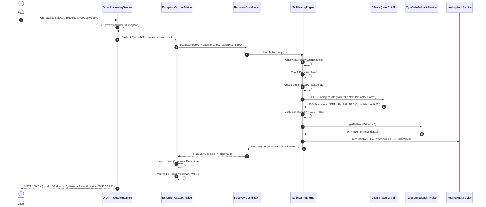

# RuntimeHeal AI — Architectural Overview & System Specification

> **Detect. Understand. Recover.**  
> An AI-Driven Runtime Self-Healing Framework for Java Applications Using ByteBuddy and Local Large Language Models.

---

## 1. System Context & Component Diagram

```mermaid
flowchart TD
    Client["Client / Browser / REST Caller"] -->|HTTP Request| Controller["Spring Boot Controller Layer"]
    Controller -->|Method Call| Service["Application Business Services"]
    
    subgraph AgentLayer ["ByteBuddy Java Agent Layer (JVM In-Process)"]
        Service -->|Method Exit & Exception Interception| Advice["ExceptionCaptureAdvice"]
        Advice -->|Dispatch Failure Context| Dispatcher["TelemetryDispatcher"]
        Advice -->|Evaluate Healing| Coordinator["RecoveryCoordinator"]
    end

    subgraph BackendCore ["RuntimeHeal AI Backend Core Engine"]
        Dispatcher -->|Stream Incident| Store["TelemetryStoreService"]
        Coordinator -->|handleRecovery()| HealingEngine["SelfHealingEngine"]
        
        HealingEngine --> PolicyCheck{"Safety Guardrails"}
        PolicyCheck -->|Denylisted Method| BlockPolicy["BLOCKED_POLICY"]
        PolicyCheck -->|Circuit Breaker OPEN| BlockCB["BLOCKED_CIRCUIT_BREAKER"]
        PolicyCheck -->|Pass| LlmService["LlmDiagnosticService"]
        
        LlmService -->|Format Prompt & Schema| OllamaClient["OllamaClient"]
        OllamaClient -->|POST /api/generate| Ollama[("Local Ollama LLM\nqwen2.5:3b")]
        LlmService -.->|Fallback Heuristics| FallbackRules["Rule-Based Heuristic Engine"]
        
        LlmService -->|Diagnostic Report| StrategyExec{"Recovery Strategy"}
        StrategyExec -->|RETURN_FALLBACK| FallbackProvider["TypeSafeFallbackProvider"]
        StrategyExec -->|RETRY| RetryEngine["Reflective In-Process Retry"]
        StrategyExec -->|SKIP_OPERATION| SkipEngine["Void/Default Bypass"]
        
        FallbackProvider --> ReturnDecision["RecoveryDecision.heal(fallbackValue)"]
        RetryEngine --> ReturnDecision
        SkipEngine --> ReturnDecision
        
        HealingEngine --> Audit["HealingAuditService (In-Memory Ring)"]
    end

    ReturnDecision --> Advice
    Advice -->|thrown = null, set returned| Service
    Service -->|200 OK + Healed Fallback| Controller
    Controller --> Client

    subgraph Observability ["Real-Time Observability & Management"]
        Audit --> API["/api/healing/* REST Endpoints"]
        Store --> API
        API --> Dashboard["Embedded Web Dashboard\n(http://localhost:8080/)"]
    end
```

---

## 2. Sequence Diagram: Live Exception Interception & Self-Healing



---

## 3. Core Package Structure

```
com.runtimeheal/
├── agent/                         # ByteBuddy Java Agent (Isolated ClassLoader)
│   ├── RuntimeHealAgent.java      # Premain & Dynamic AgentMain hooks
│   ├── advice/                    # ExceptionCaptureAdvice (Bytecode interception)
│   ├── annotation/                # @SelfHealingTarget marker annotation
│   ├── recovery/                  # RecoveryCoordinator, RecoveryHandler SPI, RecoveryDecision
│   ├── telemetry/                 # TelemetryDispatcher, CapturedFailureEvent, RecursionGuard
│   └── transformer/               # SelfHealingClassTransformer (Service-scoped matcher)
│
└── backend/                       # Spring Boot 3 Engine & Observability
    ├── RuntimeHealApplication.java
    ├── agent/                     # AgentBootstrapService & AgentController
    ├── health/                    # HealthController & Actuator probes
    ├── llm/                       # OllamaClient, DiagnosticPromptBuilder, LlmDiagnosticService
    ├── recovery/                  # SelfHealingEngine, CircuitBreakers, TypeSafeFallbackProvider
    │   ├── config/                # HealingPolicyProperties
    │   ├── controller/            # HealingController (/api/healing/*)
    │   ├── model/                 # HealingActionRecord, MethodCircuitBreaker, CircuitBreakerState
    │   ├── provider/              # TypeSafeFallbackProvider
    │   └── service/               # SelfHealingEngine, CircuitBreakerRegistry, HealingAuditService
    ├── sample/                    # Sample application & fault injection endpoints
    └── telemetry/                 # TelemetryStoreService, AgentTelemetryEvent
```

---

## 4. Key Endpoints Reference

| Category | HTTP Method | Endpoint | Description |
|---|---|---|---|
| **Dashboard** | `GET` | `/` or `/index.html` | Real-time dark-themed observability dashboard |
| **Agent** | `GET` | `/api/agent/status` | ByteBuddy agent health, attach mode, target package |
| **Telemetry** | `GET` | `/api/telemetry/incidents` | List captured `FailureContext` incidents |
| **Telemetry** | `GET` | `/api/telemetry/summary` | Incident count breakdown by exception type |
| **Diagnostics**| `GET` | `/api/diagnostics/health` | Local Ollama connectivity and model configuration |
| **Diagnostics**| `POST`| `/api/diagnostics/analyze/{id}` | Generate AI diagnostic report for captured incident |
| **Healing** | `GET` | `/api/healing/actions` | Audit log of all automated self-healing actions |
| **Healing** | `GET` | `/api/healing/summary` | Aggregate recovery metrics and success rate |
| **Policy** | `GET` | `/api/healing/policy` | View active safety guardrails and circuit breaker states |
| **Policy** | `POST`| `/api/healing/policy` | Dynamically update policy parameters |
| **Policy** | `POST`| `/api/healing/circuit-breaker/reset` | Reset all or individual circuit breakers |
| **Sample** | `GET` | `/api/sample/arithmetic` | Fault injection: ArithmeticException (/ by zero) |
| **Sample** | `GET` | `/api/sample/npe` | Fault injection: NullPointerException |
| **Sample** | `POST`| `/api/sample/illegal-argument` | Fault injection: Transactional validation (Denylisted) |
| **Sample** | `GET` | `/api/sample/timeout` | Fault injection: Simulated external gateway latency |
